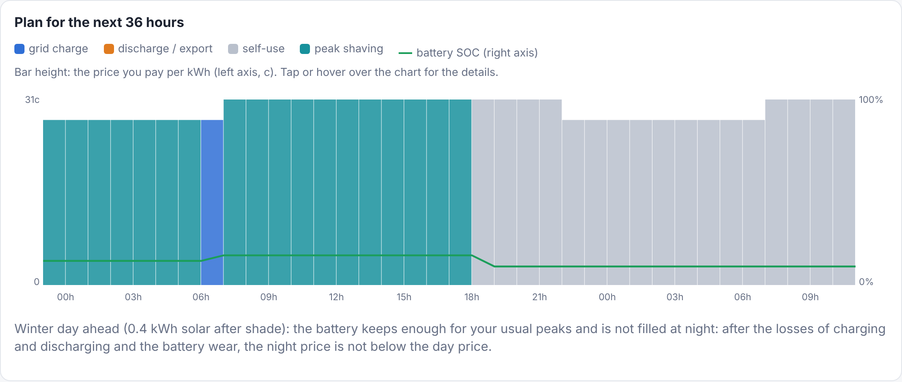
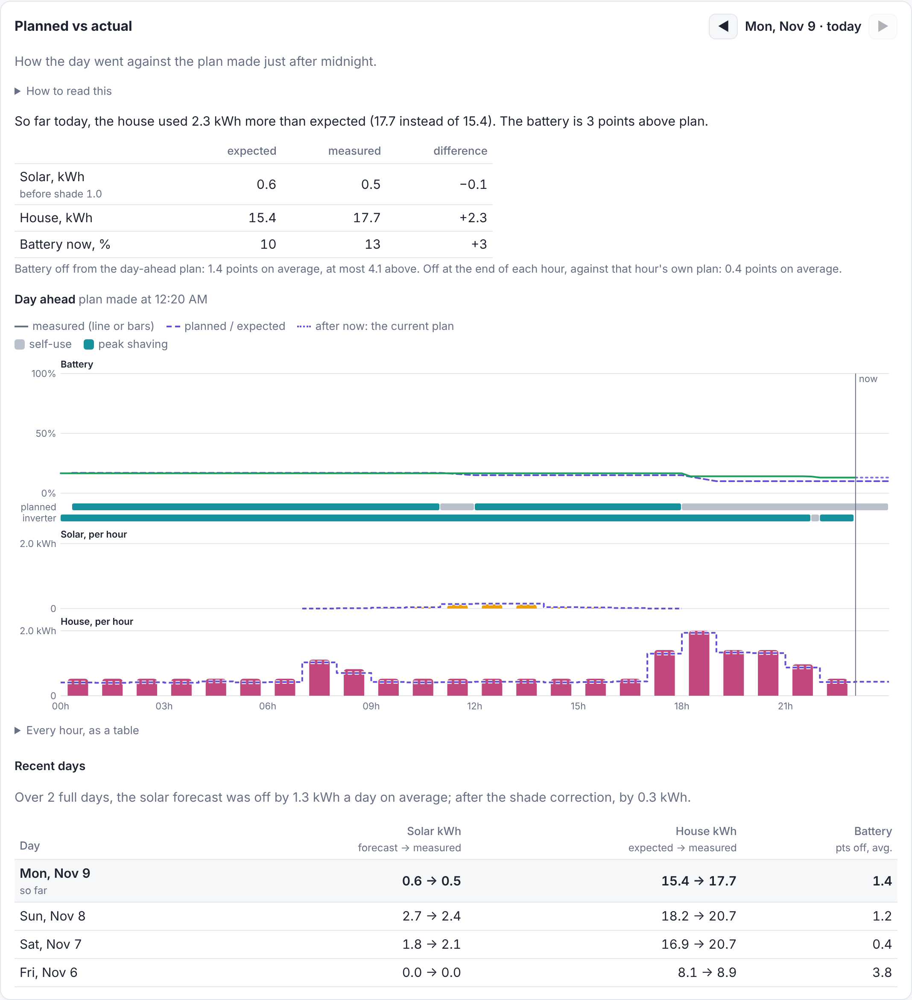
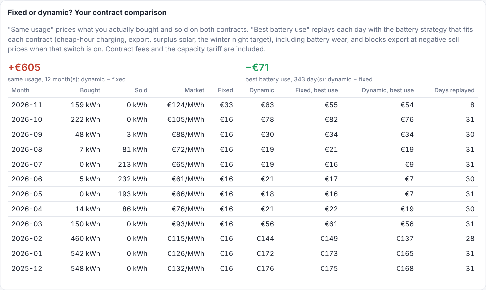
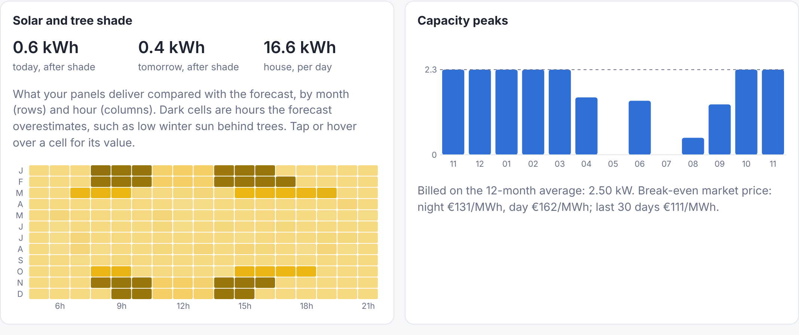
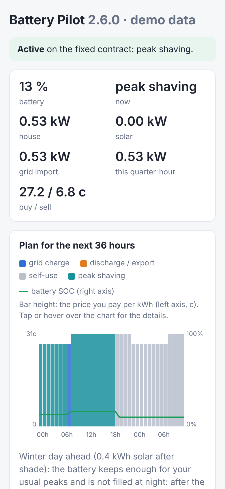
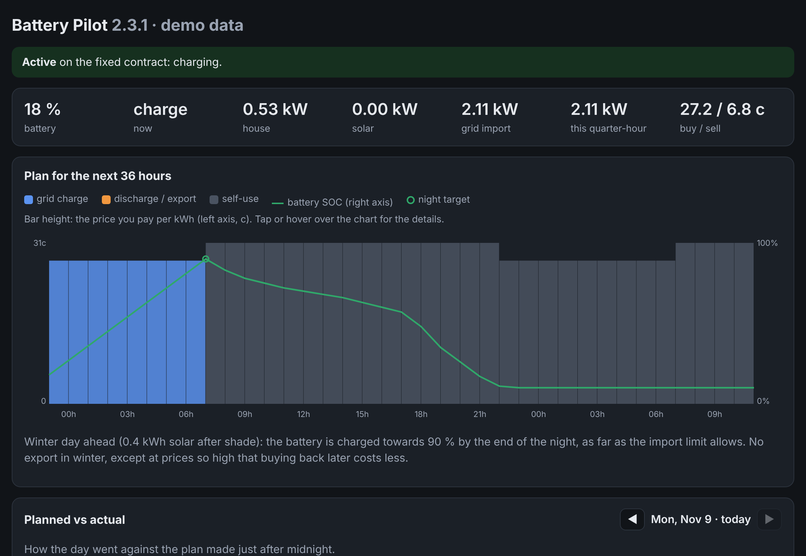

# Battery Pilot

A Home Assistant app (add-on) that steers a home battery on a **Solis** hybrid
inverter. It works out the cheapest way to use the battery from your electricity
contract, the solar forecast and the capacity tariff. It also tells you whether a
**fixed or a dynamic contract** would be cheaper for your house, using your own
measured energy.



*Demo data. Teal bars are hours in the inverter's peak-shaving mode: the grid feeds the
house and the battery (the green line) is kept for the evening cooking peak. On these
day/night rates, filling the battery at night would cost more than it saves.*

## What it does

- **Plans the battery for the next 36 hours**: self-use, grid charge, export or the
  inverter's peak-shaving mode or its feed-in priority ("solar hold": surplus is exported
  and the battery keeps its room for later) in each hour or quarter-hour. It weighs your contract's prices, battery losses and wear.
- **Measures the battery's real round-trip efficiency** from its own records and shows it next
  to the setting. It does not change the plan by itself.
- **Keeps your capacity-tariff peak low.** Grid charging follows the house load under
  the import limit, and the battery keeps enough energy for your usual cooking peaks.
- **Handles winter.** On a dull day ahead the battery is charged at night to carry the
  house, when the night price is low enough to pay for the losses and the wear.
  Otherwise it is kept for your peaks.
- **Learns the shade of your trees** for every month and hour, and corrects the solar
  forecast with it.
- **Shows planned vs actual**, day by day: the battery level and solar the plan expected
  against what really happened.
- **Earns from price spikes**: charges above the import limit, or sells below the reserve,
  when that clearly pays more than the higher capacity peak or buying the energy back.
- **Compares fixed and dynamic contracts** every month, on your measured usage and
  with the battery used the best way for each contract.
- **Alerts your phone**: capacity peak warnings, a monthly verdict, reminders before
  your fixed price ends.

It starts in **shadow mode**: it plans and compares, but does not touch the inverter
until you switch on **Battery Pilot control**.

## Install

1. In Home Assistant: Settings → Apps (Add-ons) → store → ⋮ → **Repositories**, add
   `https://github.com/Azer1652/hassSolarBattery`.
2. Install **Battery Pilot**, check the **Configuration** tab, **Start**.
3. Open **Battery Pilot** in the sidebar.

You need the **Solis Modbus** integration (HACS) and a **solar forecast** in the Energy
dashboard (e.g. Forecast.Solar). For dynamic prices and the contract comparison you also
need **ENTSO-e** or **Nord Pool** (HACS). The **Companion app** is needed for phone alerts.

## What it reads, changes and lets you set

The full guide is [battery_pilot/DOCS.md](battery_pilot/DOCS.md); Home Assistant shows
it on the app's Documentation tab.

- **[What it reads, and why](battery_pilot/DOCS.md#what-battery-pilot-reads-and-why):**
  - every 10 seconds: grid import and export, house load, solar power, battery SOC and
    voltage;
  - every 5 minutes: market prices and the solar forecast;
  - once, on the first start: your history from the recorder.
- **[What it changes](battery_pilot/DOCS.md#what-battery-pilot-changes):**
  - on the Solis, only while you allow it: the time-of-use switch, *allow grid
    charging*, the charge and discharge current, and slot 1's charge and discharge
    times (always for the current hour only), plus the export limit at negative prices
    if you switch that on;
  - in Home Assistant: two switches it creates, its own `sensor.battery_pilot_*`
    sensors, and notifications.
- **[All settings](battery_pilot/DOCS.md#all-settings):** your contract, grid and
  capacity tariff, battery, planning and inverter, each with its default and what it
  changes.
- **[Sensors it publishes](battery_pilot/DOCS.md#sensors-it-publishes).**

The repository holds no personal data: your entities and rates live in the app's
settings on your own Home Assistant. The defaults are a Flemish Eneco contract on a
Fluvius connection with a 16 kWh battery.

## Screenshots

All with demo data: a simulated house replayed through the app's own code.

**Planned vs actual.** What the plan expected for the battery and the solar against what
happened: above, the plan made just after midnight; below, the plan in force each hour.



**Fixed or dynamic?** Every month priced on both contracts, as you used it and with the
best battery strategy for each.



**Tree shade and capacity peaks.** Dark cells are hours the forecast overestimates, here
low winter sun behind trees. On the right are the monthly peaks against the import limit.



**The whole page**, on a phone and in dark mode:

<p>
  
  
</p>

[Full page](docs/screenshots/overview.png)

## Development

```bash
pip install -r requirements-dev.txt
pytest                                   # the whole suite, including simulated nights and weeks
python tools/yearsim.py                  # a synthetic year: monthly costs for both contracts
python tools/demo_dashboard.py           # the dashboard with demo data on http://127.0.0.1:8765/
node tools/screenshots.cjs               # regenerate docs/screenshots (needs Playwright)
```

CI runs ruff, the tests on Python 3.12 and 3.13, the Home Assistant add-on linter and an
image build. See [CLAUDE.md](CLAUDE.md) for the architecture.
