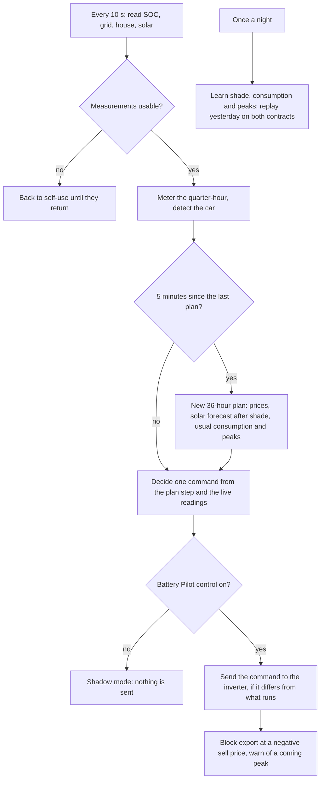
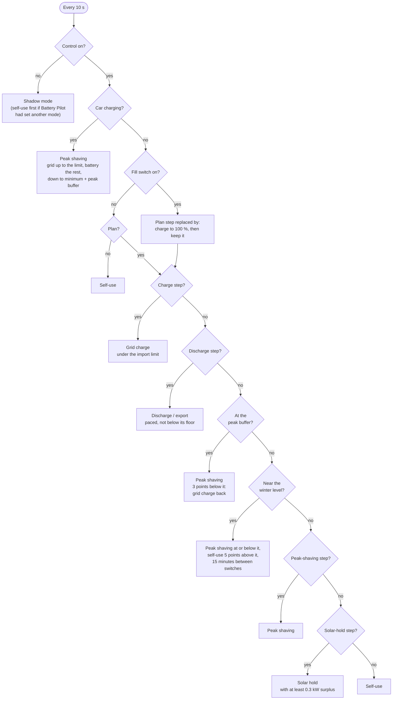
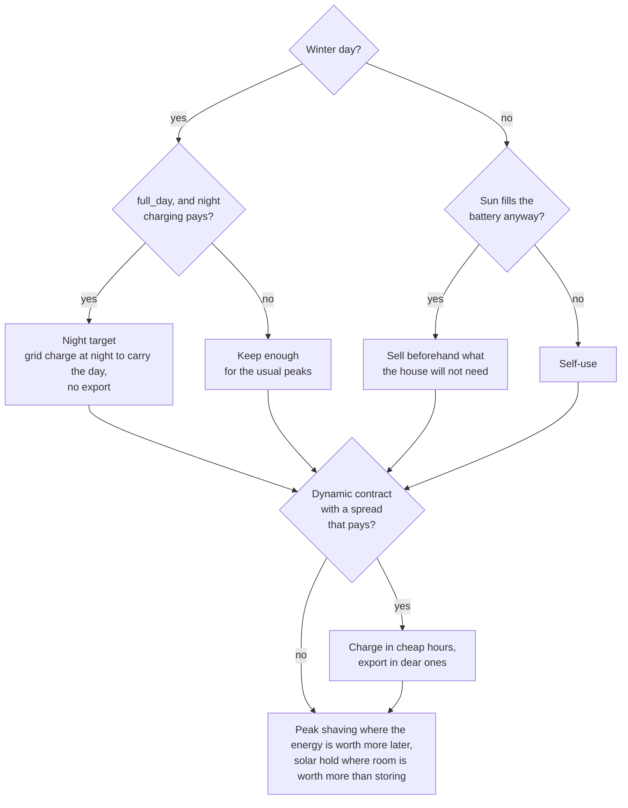
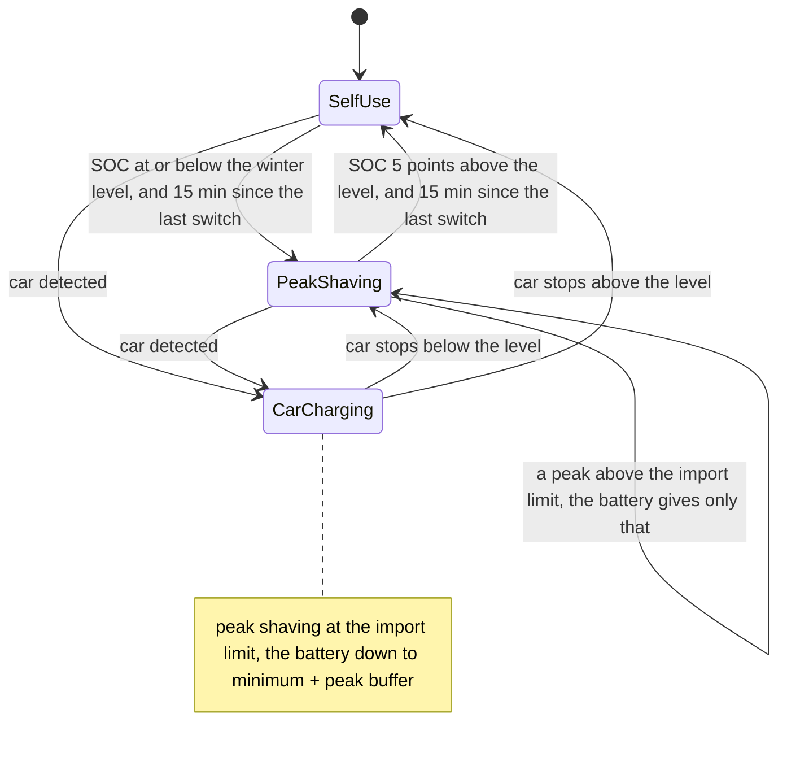
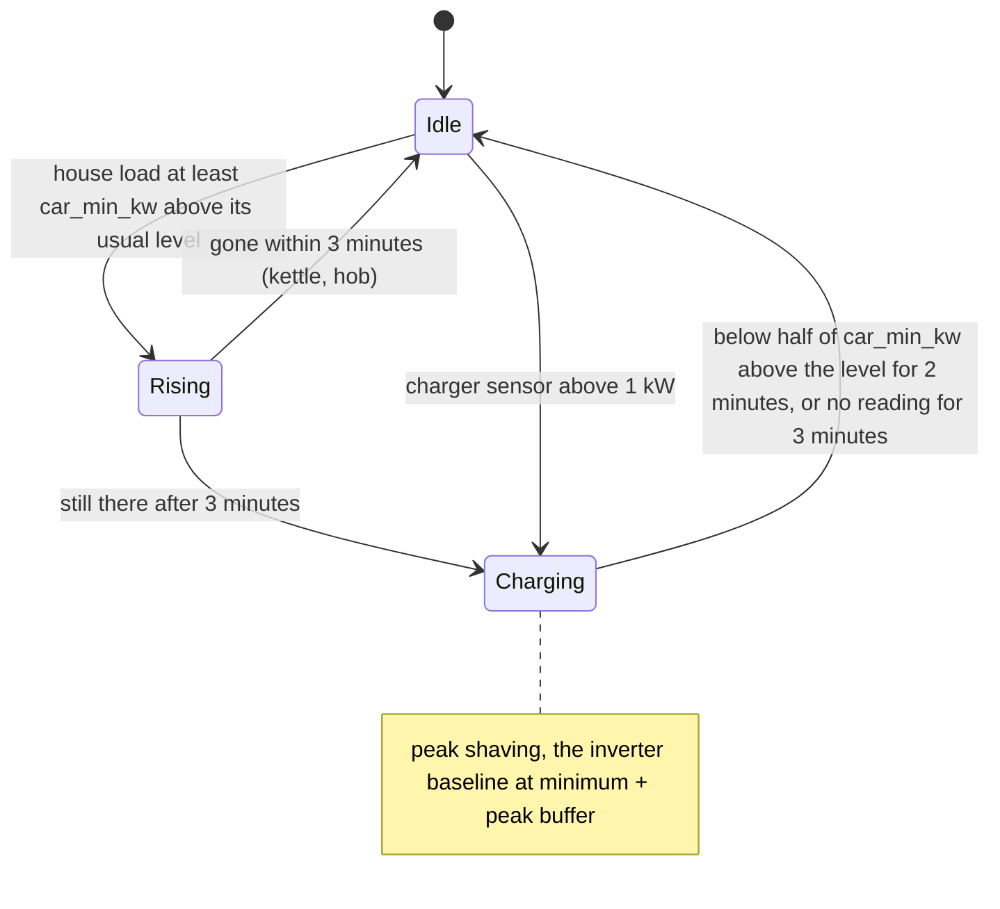
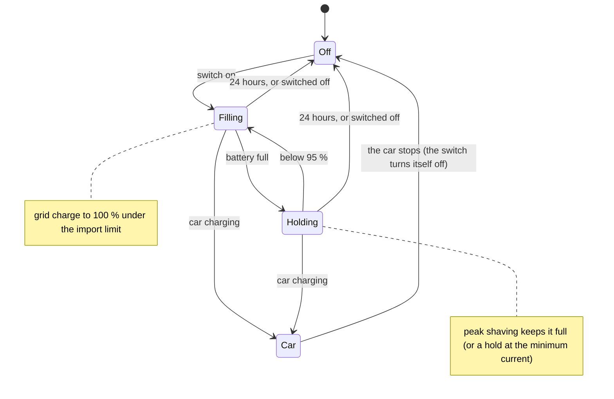

# Battery Pilot

Battery Pilot steers a home battery on a Solis hybrid inverter so it costs you as
little as possible, and tells you whether a fixed or a dynamic electricity contract
would be cheaper for your house. It runs all the time and has its own page in the
sidebar.

The page has tabs under the figures at the top: *Plan*, *Planned vs actual*, *Fixed or
dynamic*, *Solar*, *Peaks*, *House*, *Log* (inverter commands and events) and *Settings*. It
opens on the tab you used last.

The *House* tab shows the household peaks Battery Pilot has learned: for each weekday and
hour, the highest quarter-hour your house typically reaches (cooking, kettle, dishwasher),
with the car left out. They are learned every night; recent weeks count most (about three
weeks of memory), and an hour not learned yet borrows the same hour of the other days. Hours
above the import limit are red: the plan keeps enough battery to cover them. Tap or hover
over a cell (or focus the chart and use the arrow keys) for the peak and the average load.

*Demo data. Each bar is one hour or quarter-hour: its height is the price you pay per kWh
(left axis), its colour what the inverter does then (blue: grid charge). Green: the battery level
(right axis); the circle is the night target. Tap or hover over the chart for the details.*

The bar colours follow the inverter, not only the plan. Each hour's mode is worked out with the
same rules as the live control (see *Modes of operation*), so the chart includes the winter level
and peak buffer with their bands and waits, the car charging now, the fill switch, a charge
paused for room under the limit, and solar hold's 0.3 kW threshold.

- **Now:** the bar under the "now" line is the inverter's real mode. The figure at the top shows
  it too; in shadow mode it says what the inverter would do.
- **Dashed lines** mark the winter level (on winter days) and minimum + peak buffer: the levels
  where peak shaving starts.
- **The tooltip** gives the inverter mode and why. When the plan's own energy count differs, it
  says so too. For example, in a sunny hour below the winter level the plan counts self-use
  (the sun charges the battery), while the inverter stays in peak shaving; the energy is the same.

What it does:

- **Plans the battery** for the next 36 hours from your contract's prices, your
  house's consumption pattern, and the solar forecast corrected for shade. Each
  quarter-hour or hour is self-use, grid charge, or discharge/export. Charging and
  exporting only happen when the price difference beats battery losses and wear.
- **Keeps your capacity peak low.** Grid charging stays under the import limit and
  follows the house load. Charging pauses when the quarter-hour heads over the limit,
  so the battery can cover a cooking peak.
- **Handles winter.** On a dull day ahead (corrected solar below the threshold), the
  battery is grid-charged during the night to carry the house through the day. In
  winter no battery energy is exported, except at a price so high that buying it back
  later costs less.
- **Learns your tree shade.** It compares what your panels deliver with the forecast
  for every month and hour of the day. Low winter sun behind trees gets its own
  correction; summer noon keeps its own.
- **Trades with the grid when it pays, and says why not.** Buying a kWh to sell it
  later earns `sell price × round-trip efficiency − wear − buy price`. The grid fees are
  on every kWh bought, so with the default rates a kWh bought at a market price of 0 must
  be sold at about 180 €/MWh to break even. Buying cheap to avoid buying dear needs a much
  smaller difference, about 33 €/MWh, but is limited to what the house uses. The plan
  card shows the best pair of hours of the next 24 hours with your rates, and the selling
  price from which trading would pay.
- **Follows today's weather.** When the panels gave clearly less (or more) in the last
  three hours than the forecast after shade, the rest of today is planned lower (or
  higher). The correction fades over the following hours and never touches tomorrow.
  Quarter-hours in which the inverter held the panels back do not count. The page says
  so when the difference is 15 % or more.
- **Knows when the car charges** (off by default). It sees the car as a jump in house
  consumption, or reads the charger's own power sensor. While the car charges it uses the
  inverter's peak shaving, so the grid gives up to the import limit and the battery the
  rest, and it keeps the car out of what it learns as usual consumption.
- **Shows planned vs actual**, day by day: the battery level and solar the plan
  expected against what really happened, so you can see how good the prediction is.
- **Compares contracts** with your own measured energy, in two ways (see below).
- **Alerts you** on your phone: capacity peak warnings, a monthly verdict, reminders
  before your fixed price ends, and when the market crosses your break-even.

## Before you start

1. **Solis Modbus** (HACS) with a working local connection to the inverter.
2. A **solar forecast** in the Energy dashboard (Settings → Dashboards → Energy →
   Solar panels → forecast), for example **Forecast.Solar**. Leave its damping off:
   Battery Pilot learns the shade itself.
3. For dynamic prices and the comparison: **ENTSO-e** (HACS, area BE) or **Nord Pool**
   (HACS). Without one, Battery Pilot still plans on a fixed contract.
4. The **Home Assistant Companion app** on your phone, for alerts.

## Install

1. Settings → Apps (Add-ons) → store → ⋮ → **Repositories**, add
   `https://github.com/Azer1652/hassSolarBattery`.
2. Install **Battery Pilot**, check the **Configuration** tab, **Save**, **Start**.
3. Open **Battery Pilot** in the sidebar.

The log lists every entity it found and how. If a required entity is missing or
several match, it says which setting to fill in (Configuration → *Show unused optional
configuration options*).

### Shadow mode first

Battery Pilot starts in **shadow mode**: it plans, compares and learns, but does not
touch the inverter. Watch the plan for a few days. When you trust it, switch on
**Battery Pilot control** (Settings → Devices & services → Helpers).

### Coming from Battery Playbook

Battery Pilot takes over by itself on its first start. It switches off the old
automations so they can't drive the inverter, takes over your contract history, and
removes the old package files (a copy is kept in the app's storage). Then restart
Home Assistant once and uninstall the Battery Playbook app.

## How it decides

| Situation | What the battery does |
| --- | --- |
| Dull day ahead (winter), strategy `full_day` | When the night price is low enough to pay for it (see *Winter strategy*): charged from the grid at night, at the cheapest moments, to the **night target** by the time the night tariff ends. The target is what the house needs until evening after the corrected solar, plus the safety margin, but never more than the night window can charge under the import limit. No battery export, except at a price so high that buying the energy back later costs less. |
| Dull day ahead (winter), strategy `peaks_only` | Only enough charge to cover your usual quarter-hour peaks (cooking, kettle) under the import limit, plus whatever the prices make worth it. |
| Dull day ahead (winter), night charging does not pay | No night target: the battery is not filled at a loss. It keeps enough for your usual peaks, as with `peaks_only`. |
| Dull day ahead (winter), with *Winter: keep the battery at* | Self-use stops at that level; at or below it the inverter is in peak shaving, so the house runs on the grid (the battery covers only what is above the import limit) and the level is kept for the car. Nothing is bought to fill it back: solar and the night target do. Self-use returns only 5 points above the level, at least 15 minutes after the last switch. |
| Peak shaving (when the inverter has the switch) | In hours where the battery's energy is worth more later (a dearer hour of the plan, or a peak it must cover), the inverter is put in its **peak-shaving mode**: the grid feeds the house up to the *Grid import limit* and the battery only gives what is above it. Typical: the night hours on a day/night contract when the battery cannot carry both the night and the day. It is never used just to end the plan with a fuller battery. |
| Solar hold (when the inverter has the switch) | While there is solar surplus, the inverter's **feed-in priority** is switched on: the surplus is exported and not stored, and the battery keeps its room for later hours in which surplus cannot be sold (a negative sell price with export blocked, or more surplus than the export limit). The plan uses it only where it lowers the cost. In this mode the battery does not feed the house, so Battery Pilot switches it on only with at least 0.3 kW of surplus and returns to self-use when the surplus is gone. |
| Any day | The battery keeps enough energy for the quarter-hour peaks Battery Pilot has learned for each weekday and hour, topping up shortly before if needed. |
| Sunny day ahead | No grid charging: the sun fills the battery. |
| Sunny day ahead that fills the battery anyway | What the house won't need before the sun covers it (shade-corrected) is sold beforehand, when the room is worth more than the sale. On a dynamic contract it sells in the best-paid hours or quarter-hours first, at full power, never below *Battery reserve for export*, and even buys the house's night energy back when the evening price beats it. On a fixed contract the injection price is the same every hour, so it only sells early when tomorrow's surplus would exceed the export limit. |
| Fixed day/night contract | Buying at night to use by day only happens when the night rate, after the losses of charging and discharging and the battery wear, is below the day rate. With the default rates it is not: no night charging, in summer or in winter. |
| Dynamic contract | Also charges in cheap hours and exports in expensive ones, when the spread beats losses + wear, filling the battery completely when the sale pays for all of it. The best-paid slots get full power first. |
| Price spike (very low or very high) | Charges above the import limit, as fast as the battery takes, when that earns more than the higher capacity peak costs, priced as Fluvius bills it: the month's highest quarter-hour (at least the billed minimum) counts once in the 12-month average, so a peak this month already has costs nothing extra. At a price so high that buying the energy back later costs less, it also sells below the reserve, down to the battery minimum, even in winter. The plan card says when and why. |
| Negative sell price | With **Battery Pilot block negative export** on and an export-limit entity, export is set to 0. The inverter then holds the panels back; those quarter-hours are not learned as shade. |
| Quarter-hour heading over the limit | Charging pauses; the battery helps the house. You get a phone warning when a peak is coming (above the higher limit while the plan pays for one). |
| The minutes before a new price | The plan is redone every 5 minutes. A charge or export that the plan continues after the next price boundary carries on through the last minutes before it, without stopping and starting again. Nothing starts early in those minutes. |

Charge and discharge commands only cover the current clock hour, and Battery Pilot puts
the inverter back in self-use when it stops, when its measurements are lost and when
*Battery Pilot control* is switched off. See *When something goes wrong* below.

## Modes of operation

The diagrams below render on GitHub. In Home Assistant's Documentation tab they show as
text.

### The loop

Battery Pilot runs one loop, every 10 seconds. The plan is redone every 5 minutes and once a
night it learns.

### The inverter modes

The inverter is always in one of these modes. While *Battery Pilot control* is off, Battery
Pilot sends nothing (shadow mode). It plans and shows what it would do.

| Mode | What the inverter does | Who asks for it | How it ends |
| --- | --- | --- | --- |
| **Self-use** | Solar first feeds the house. The battery stores the surplus and covers what the house needs. Grid import happens only when the battery is at its floor. | The plan, a reached target, a paused charge, lost measurements, *Battery Pilot control* off, the app stopping | Another mode is asked for |
| **Grid charge** | Charges from the grid. The current follows the house load, so import stays under the import limit (or under the higher limit the plan pays for at a price spike). | The plan (night target, cheap hours, peak cover), the fill switch, the peak buffer refill | The target is reached, the slot ends, or the quarter-hour heads over the limit (charging pauses in self-use) |
| **Discharge / export** | Sells from the battery, paced to the plan's SOC, never below *Battery reserve for export* (except at an extreme price). | The plan (a dynamic price peak, or room for tomorrow's sun) | The plan's SOC or the floor is reached, or the slot ends |
| **Peak shaving** | The grid feeds the house up to the *Grid import limit*. The battery only gives what is above it, and its baseline is the minimum, so the inverter does not refill from the grid. | The plan (energy worth more later), the car, the fill switch once full, the peak buffer, the winter level | See the decision order below; each trigger has its own way back |
| **Solar hold** | The *feed-in priority*: solar surplus is exported, and the battery keeps its room for later. The battery does not feed the house. | The plan, with at least 0.3 kW of surplus | Surplus gone (not within 120 s of the last command) |

Next to the mode, *Battery Pilot block negative export* sets the export limit to 0 W while
the sell price is negative. It puts it back when the price is positive again.

### Decision order

Each loop takes the first rule that applies, from top to bottom. Higher rules win. The plan chart
runs the same rules over the coming hours to colour its bars.

Notes on the rules:

- **Car:** peak shaving needs the peak-shaving switch. The car starts it once the house asks
  more than the import limit.
- **Charge step:** only while the battery is below the step's SOC. Charging pauses in
  self-use while the house needs the room under the limit.
- **Peak buffer:** only with *Peak buffer* set.
- **Winter level:** only on a winter day with *Winter: keep the battery at* set, and while
  the battery is less than 5 points above the level.
- **Solar hold:** below 0.3 kW of surplus the inverter stays in self-use.

### What the plan chooses

The plan picks the cheapest mode for each hour (or quarter-hour) of the next 36 hours. It
counts prices, losses, battery wear, the capacity tariff and your usual peaks. See *How it
decides* above.

A winter day is one whose solar forecast, after shade, is below *Winter day when solar is
below*.

### The peak buffer and the winter level

The peak buffer and the winter level both stop self-use at a SOC and switch to peak shaving
below it. They differ in how they get back.

| | Peak buffer (`peak_buffer_pct`) | Winter level (`winter_hold_soc`) |
| --- | --- | --- |
| When | Always | Winter days only, decided once per day |
| Level | Minimum + buffer | The setting (only when above minimum + buffer) |
| Peak shaving from | At or below the level | At or below the level |
| Self-use again from | 2 points above it | 5 points above it, and at least 15 minutes after the last switch |
| Refill from the grid | Yes, under the import limit, from 3 points below | No: only solar and the plan's own charging fill it |
| The car may use it | No: the car stops at the buffer | Yes, down to minimum + buffer |

The band and the wait keep the inverter from flipping between self-use and peak shaving.
Without a grid refill, only solar can lift the battery the 5 points back to self-use.

On the evening of a winter day followed by a day with enough sun (not a winter day), the winter
level is let go from *Night start*: tomorrow's sun refills the battery, so what was kept would
only push solar to the grid. When tomorrow is not forecast yet, or is dull too, the level stays.

### The car

### The fill switch

## The comparison

- **Same usage:** every quarter-hour, what you actually bought and sold is priced on
  both contracts. It is exact, but your battery behaved as it does on your current
  contract. In a month that has market prices for only part of its quarter-hours (the
  price sensor was added during the month), both contracts are priced on the
  quarter-hours that have one.
- **Best battery use:** every night, yesterday is replayed with your measured
  consumption and solar. For each contract the planner decides every hour as it would
  have on that contract (cheap-hour charging, export, selling surplus solar, the
  winter night target). A simulated battery follows its commands, and wear is
  included. What that battery holds more (or less) at the end of the day than at its
  start is credited (or charged) at the value the plan gives stored energy, so energy
  bought in the evening for tomorrow does not count against today. With *Battery Pilot block negative export* on (and an export-limit
  entity), the replay also blocks export whenever that contract's sell price is
  negative, as Battery Pilot would; otherwise those exports cost money. While export
  was really blocked the inverter held your panels back, so for those quarter-hours the
  replay takes the shade-corrected forecast when it is higher than what was measured. A
  day counts only when both contracts could be replayed. This answers:
  what would each contract have cost me, with the battery used the best way for it?

Both include the contract fees and the capacity tariff, for the part of the month the
amounts cover: a month that is not complete (the current one, or the month you installed
the app or added prices) shows "3.2 of 30 days" and carries the fees of those days only.
A few days say little yet, and the two views can cover different spans: same usage the
quarter-hours with a price, best use whole replayed days (the kWh each replay bought are
shown under its amount). The sidebar page shows every
month; the sensor `sensor.battery_pilot_contract_comparison` holds the 12-month
difference (negative means dynamic is cheaper).

The page also shows the shade Battery Pilot learned for every month and hour (dark =
the forecast is too high, e.g. low winter sun behind trees) and your monthly peaks. Tap or
hover over a cell or a bar for its value:

## Planned vs actual

The page keeps what the plan predicted and what really happened, so you can see how good
the prediction is. Step through the days with ◀ ▶, or pick one from the list of recent
days. Each day compares the measurements with the **day-ahead plan**: the plan made just
after midnight (right after the nightly learning), with the solar forecast after shade and
the usual consumption it was based on. Errors in those forecasts add up over the day, so
this shows how far the real day drifted from what was expected.

- **In words:** one or two sentences on what differed (the house used more or less than
  expected, the panels gave more or less than forecast, from 0.5 kWh and 15 % on) and where
  the battery is against the plan. On days with *Battery Pilot control* off (shadow mode)
  a note says that the inverter did not do the planned grid charging or export, so the
  battery can differ from the plan there.
- **Figures:** expected, measured and the difference for the solar (and the forecast before
  the shade correction), the house and the battery now or at the end of the day. Under it:
  how many SOC points the battery was off from the day-ahead plan on average and at worst,
  and how far it was off at the end of each hour against the plan in force at the start of
  that hour (each of those starts from the real battery level, so its error is one hour's
  worth).
- **The chart,** from midnight to midnight, in four panels: the battery level; two strips
  with what the plan wanted (grid charge, discharge, self-use) and what the inverter did;
  the solar per hour; and the house consumption per hour. Solar and house share one kWh
  scale. In every panel a solid line or bars is what was measured and a dashed line what
  the plan expected; today, a dotted line continues with the current plan after "now".
  Tap or hover over the chart (on a phone, slide a finger sideways along it), or focus it
  and use the arrow keys, for the values at each moment, including the forecast without
  shade. The table under it has every hour, with each hour's own plan too. On a day without
  a day-ahead plan (the app started during the day), the plan of each hour is shown instead.

The list of recent days shows, per day, the solar forecast after shade against what was
measured, the expected house consumption against what was measured, and how many SOC
points the battery was off on average; days in shadow mode are marked. The line above it
says how much the shade correction improves the solar forecast over all stored days.

Days are kept for 60 days.

## What Battery Pilot reads, and why

Battery Pilot finds these entities by itself. To pick a different one, fill in its
setting on the Configuration tab (*Show unused optional configuration options*). If a
**required** one is missing, or several entities match, Battery Pilot stops and the
log says which setting to fill in.

### Measurements (read every 10 seconds)

| Setting | Found automatically | Needed | Used for | Without it |
| --- | --- | --- | --- | --- |
| `grid_import_power` | a sensor named like `grid_import_power` or `import_power` | required | The quarter-hour meter: monthly capacity peak, the projection of where this quarter-hour is heading, peak warnings, pausing charging, and the "same usage" bill (kWh bought). | Battery Pilot does not start. |
| `house_load_power` | `household_load_power`, `house_load` or `load_power` | required | Grid-charge current that keeps import under the limit (it follows the house load), learning your consumption pattern and your usual quarter-hour peaks, the night target, and the nightly replay. | Battery Pilot does not start. |
| `battery_soc` | `battery_soc` | required | Planning from the battery's real state, stopping a charge or export at its target, the nightly replay's starting point. | Battery Pilot does not start. |
| `grid_export_power` | `grid_export_power` or `export_power` (not an export *limit*) | optional | kWh sold, in the "same usage" bill. | Sold kWh count as 0 in the comparison. |
| `pv_power` | `total_pv_power` or `pv_power` | optional | Learning tree shade (what the panels delivered vs the forecast), the charge current (solar adds room under the limit), the nightly replay. | Shade is not learned (the forecast is used as is); hours without solar data are skipped, never counted as dark, and so are hours in which export was blocked (the inverter holds the panels back then). |
| `battery_voltage_sensor` | `battery_voltage` | optional | Turning amps into kW for the charge current and the plan. | The *Battery nominal voltage* setting is used. |

Power sensors can be in W or kW: the unit is read from the entity.

### Prices and forecasts (read every 5 minutes)

| Setting | Found automatically | Needed | Used for | Without it |
| --- | --- | --- | --- | --- |
| `price_sensor` | `average_electricity_price` (ENTSO-e: the sensor that carries the price list; `current_electricity_market_price` leads to it), `nordpool…` or `electricity_price` | for a dynamic contract | The hourly or quarter-hour market prices in its attributes (ENTSO-e `prices`, Nord Pool `raw_today`/`raw_tomorrow`, or a generic list), EUR/kWh or EUR/MWh from its unit. They drive the dynamic plan, the dynamic side of the comparison, the fixed contract's sell price (it follows the month's market average), break-even alerts and blocking export at negative prices. | Planning still works on a fixed contract; the comparison and dynamic prices are not available. With a flat fixed sell rate, set *Fixed: sell price × market* to 0. |
| — (Energy dashboard) | the solar forecast set up in Settings → Dashboards → Energy, read over the websocket API | recommended | Hour-by-hour solar forecast for the plan, corrected for shade. | The two daily totals below are spread over the daylight hours instead. |
| `forecast_today`, `forecast_tomorrow` | Forecast.Solar's `energy_production_today` / `_tomorrow` | fallback | Only when the Energy dashboard has no solar forecast. | No solar in the plan: every day looks like winter. |
| `forecast_power_now` | Forecast.Solar's `power_production_now` | optional | Read once from the recorder on the first start, to learn shade from the last 10 days at once. | Shade is learned from the first day on instead. |

### Solis controls (found at start; changed as listed in the next section)

| Setting | Found automatically | Needed |
| --- | --- | --- |
| `tou_switch` | switch `time_of_use` | required for the time-of-use slots (with the force action: switched off when found) |
| `grid_charge_switch` | switch `allow_grid…charge` / `grid_charg…` | required for the time-of-use slots (with the force action: switched on when found) |
| `charge_current` | number `…charge_current` (not discharge) | required for the time-of-use slots |
| `discharge_current` | number `…discharge_current` | required for the time-of-use slots |
| `charge_start`, `charge_end` | time `…charge_start…slot_1`, `…charge_end…slot_1` | required for the time-of-use slots |
| `discharge_start`, `discharge_end` | time `…discharge_start…slot_1`, `…discharge_end…slot_1` | required for the time-of-use slots |
| `export_limit` | number `export_power_limit` / `export…limit` | optional: only for blocking export at negative prices |
| `peak_shaving_switch` | switch `…peak_shaving_mode` / `…peak_shaving…` | optional: without it the plan never uses peak shaving |
| `peak_shaving_limit` | number `…peak_max_usable_grid_power` | optional: the grid power the inverter shaves to; without it the inverter's own value is used |
| `peak_shaving_soc` | number `…peak_baseline_soc` | optional: the battery level the inverter keeps while peak shaving; without it the inverter's own value is used |
| `feed_in_priority_switch` | switch `…feed_in_priority` / `…feed_in_priority_mode` | optional: without it the plan never uses solar hold |

Slot entities come in two sets on Solis Modbus (`time_charging` and
`grid_time_of_use`); the *Solis slot entities* setting picks which one. When several
entities match, the one with `solis` in its name wins.

**Two ways to charge and export.** *Solis charge command* (`charge_command`) picks one:

- **The force action** (`auto` uses it when Home Assistant has it): the Solis Modbus actions
  *Force battery charge* / *Force battery discharge* (`solis_modbus.solis_force_battery_charge`,
  `…_discharge`, `…_stop_force_charge_discharge`), the inverter's remote control. They come with
  recent versions of the Solis Modbus integration. Each command runs for 30 minutes and Battery
  Pilot sends it again every 10 minutes while it should go on, so when Battery Pilot or Home
  Assistant stops, the inverter returns to its own mode within half an hour. The time-of-use
  entities are not needed then. With several inverters on the integration, set *Solis Modbus
  slave ID* (`solis_slave`).
- **The time-of-use slots** (`time_slot`, or `auto` without the action): slot 1 of the entities
  above, set to the current clock hour.

If the page says the battery is charging but it does not, switch to the other one. The log says
at the start which one is used.

### Electric car (read every 10 seconds, only when set)

| Setting | Found automatically | Needed |
| --- | --- | --- |
| `car_charger_power` | never: only used when you set it | optional: a power sensor of the charger. When set, the car counts as charging above 1 kW and `car_min_kw` is not needed |

### Everything else it reads

- **Home Assistant's configuration:** time zone, latitude and longitude (for day/night,
  sunrise and sunset).
- **Notify actions:** to find the Companion app phone for alerts (unless *Phone
  notification action* is set).
- **Its three switches:** *Battery Pilot control*, *Battery Pilot fill battery for car* and *Battery Pilot block negative
  export*, every 10 seconds.
- **The recorder**, once on the first start: 10 days of house load, solar and forecast
  power, to learn your consumption, peaks and shade straight away.
- **Battery Playbook**, once, if it was installed: its automations and the sensors
  `sensor.cw_shadow_bill`, `sensor.ps_daily_consumption_avg` and
  `sensor.ps_monthly_peak` (see *Coming from Battery Playbook*).

## What Battery Pilot changes

### On the inverter, only while *Battery Pilot control* is on

| Command | When | What it sets |
| --- | --- | --- |
| Charge | The plan says grid-charge in this slot and there is room under the import limit (or the higher limit the plan pays for at a price spike). | With the force action: *Force battery charge* with the power (charge current × battery voltage) for 30 minutes; *time of use* off and *allow grid charging* on when those entities exist. With the time-of-use slots: charge slot 1 start/end = the current clock hour (e.g. 02:00–03:00; 23:00–23:59 in the last hour), discharge slot 1 = 00:00–00:00, *allow grid charging* on, charge current, *time of use* on. |
| Discharge (export) | The plan says export in this slot. | With the force action: *Force battery discharge* with the power for 30 minutes. With the time-of-use slots: discharge slot 1 = the current clock hour, charge slot 1 = 00:00–00:00, discharge current, *time of use* on. |
| Change current | While charging or exporting, when the right current changes by 10 A or more (house load, pacing). | Charge or discharge current only (with the force action: the force command again with the new power). |
| Renew | At every new clock hour while still charging or exporting, and every 10 minutes with the force action. | The same as Charge / Discharge. |
| Peak shaving | The plan says peak shaving in this slot (only when the peak-shaving switch was found). | *Time of use* off, peak-shaving grid power = *Grid import limit*, peak-shaving baseline SOC = *Battery minimum SOC* (so the inverter does not refill the battery from the grid by itself; or the lowest value the entity accepts), *peak-shaving mode* on. The two numbers are written only when they change. |
| Solar hold | The plan says solar hold in this slot, the *feed-in priority* switch was found and the solar surplus is at least 0.3 kW. | *Time of use* off, *feed-in priority* on. Back to self-use when the surplus is gone (not within 120 s of the last command). |
| Self-use | The plan says self-use, a target is reached, charging pauses for a peak, *Battery Pilot control* is switched off, the measurements are lost, or the app stops. | *Stop force charge/discharge* (with the force action), *time of use* off, and *peak-shaving mode* and *feed-in priority* off when Battery Pilot switched them on. Everything else is left as it is. |
| Block export | *Battery Pilot block negative export* is on, an export-limit entity exists and the sell price is below zero. | Export limit 0 W, and back to the value it had before (at most *Normal export limit*) when the price is positive again. An installation already at 0 W (zero export) is left alone. |

How the charge current is chosen: enough to reach the plan's SOC by the end of the
hour, never more than keeps grid import under the import limit with the current house
load (in 5 A steps, never above *Maximum charge current*). At a price spike that pays for
a higher capacity peak, the plan's higher limit is used instead. Charging starts only with
15 A of room, pauses below 10 A or when the quarter-hour heads 0.1 kW over the limit, and
holds at 10 A (at most 2 % above target) once the target is reached before the hour ends.
Exports never go below *Battery reserve for export*, except where the plan sells below it
at an extreme price.

### When something goes wrong

- **Measurements lost:** without the battery SOC or grid import for a minute (or a SOC
  that does not move for 30 minutes while charging or discharging), a charge or
  discharge goes back to self-use until the readings return. A missing house-load reading
  alone is estimated from the grid, solar and the charge current, so it doesn't stop a
  night charge.
- **A command fails:** it is sent again on the next tick; after three failures in a row
  the page shows the problem. With *Battery Pilot control* off, the inverter is put back
  in self-use.
- **Battery Pilot stops:** on a normal stop it puts the inverter in self-use. A force
  command ends by itself within 30 minutes. A time-of-use command covers the current clock hour, but the Solis repeats its time-of-use slot **every
  day**. After a power cut, or when Home Assistant restarts the app because it crashed or
  stopped responding, it puts the inverter back in self-use when it starts (it records
  what it left on the inverter in `/data/inverter.json`). Keep **Watchdog** switched on
  (the app's Info tab): the app reports its health to Docker, and the watchdog restarts
  it when that fails.
- **Someone else changes the inverter:** while *Battery Pilot control* is on, the
  time-of-use switch is read back every tick and corrected if something else changed it.
  With control off, your own settings are never touched.
- **The forecast or prices are unavailable:** it keeps planning with the last solar
  forecast and prices it received. Quarter-hours without a market price are priced in
  the comparison with the price of the day before (marked † on the page).

### In Home Assistant

- **Four switches**, created as normal helpers on the first start (off):
  `input_boolean.battery_pilot_control`,
  `input_boolean.battery_pilot_block_negative_export`,
  `input_boolean.battery_pilot_fill_battery_for_car` (see *Fill the battery for the car*) and
  `input_boolean.battery_pilot_force_peak_shaving` (see *Force peak shaving*).
  Battery Pilot turns the fill switch off itself when the car has charged, or after 24 hours;
  the force peak shaving switch stays on until you turn it off.
- **Its sensors**, listed below. They are updated every 30 seconds and come back
  within 30 seconds after a Home Assistant restart.
- **Notifications** in HA, and on your phone through the Companion app:
  - capacity peak warning: the quarter-hour heads more than 0.3 kW over the limit for
    2 minutes; at most once per quarter-hour;
  - monthly verdict: on the 1st at 09:00 (or the first day after, if the app was not
    running);
  - fixed price ending: 42, 14 and 3 days before (or the first day after);
  - market crossing your break-even: the 30-day average moves below your night rate or
    above your day rate.
- **Files:** none, except once when taking over from Battery Playbook. It removes the
  `battery_playbook_*.yaml` package files after a configuration check (a copy goes to
  the app's own storage), switches off the old automations, and reloads HA's YAML.
- **Its own settings**, only when you press *Save these settings* after an import (see
  *Export and import the settings*). They are saved through the Supervisor, which is why
  the app asks for access to the Supervisor API.
- **Its own storage** (`/data/state.json`): what it learned (shade, consumption, peaks),
  the comparison history and the last days of prices and measurements. In
  `/data/history`, one file per day for the last 60 days of planned vs actual;
  `/data/inverter.json`, what it left on the inverter. A damaged `state.json` is kept as
  `state.json.bad` and Battery Pilot starts fresh.

## All settings

The defaults are an Eneco contract on a Fluvius connection in Flanders (2026) with a
16 kWh battery on a Solis S6-EH1P; change them to your own. Prices are incl. VAT.

### Contract

| Setting | Key | Default | What it does |
| --- | --- | --- | --- |
| Your contract now | `contract` | fixed | Which contract's prices the battery is planned for. The comparison always shows both. |
| Fixed price ends on | `fixed_contract_end` | (empty) | Date (YYYY-MM-DD) for the reminders 6 weeks, 2 weeks and 3 days before. |
| Fixed day rate | `fixed_day_rate` | 18.59 c/kWh | Energy price on the fixed contract by day, without grid fees. |
| Fixed night rate | `fixed_night_rate` | 15.22 c/kWh | The same at night. Equal to the day rate for a single-rate contract. |
| Fixed contract fee | `fixed_yearly_fee_eur` | 65 €/year | Added in the comparison. |
| Fixed: sell price × market | `fixed_sell_mult` | 0.0798 | Fixed sell price = this × the month's average market price (EUR/MWh) + the next setting − injection fee. 0 for a flat sell rate. |
| Fixed: sell price + | `fixed_sell_add` | −2.72 c/kWh | See above; your flat sell rate if the setting above is 0. |
| Dynamic: buy price × market | `dynamic_buy_mult` | 0.102 | Dynamic buy price = (this × market + the next setting) × (1 + VAT) + grid fees. |
| Dynamic: buy price + | `dynamic_buy_add` | 0.408 c/kWh | Supplier margin, before VAT. |
| Dynamic: VAT | `dynamic_vat_pct` | 6 % | VAT on the dynamic energy price. |
| Dynamic: sell price × market | `dynamic_sell_mult` | 0.1 | Dynamic sell price = this × market + the next setting − injection fee. |
| Dynamic: sell price + | `dynamic_sell_add` | −1.3 c/kWh | Usually negative: the supplier's deduction. |
| Dynamic contract fee | `dynamic_yearly_fee_eur` | 15 €/year | Added in the comparison. |
| Grid fees and taxes | `grid_fees_c_kwh` | 11.33 c/kWh | Added to every bought kWh on both contracts. Update each January. |
| Injection fee | `injection_fee_c_kwh` | 0.19 c/kWh | Subtracted from every sold kWh on both contracts. |
| Night tariff starts | `night_start` | 22:00 | Night rate, and the window for winter night charging. The window may cross midnight (22:00–07:00) or lie inside one day (01:00–06:00). |
| Night tariff ends | `night_end` | 07:00 | On winter days the battery reaches its night target by this time. |
| Weekend is night tariff | `weekend_is_night` | on | The night rate all weekend (Flanders). |

The contract formulas in full (market prices in EUR/MWh):

- fixed buy = day or night rate + grid fees
- fixed sell = *fixed: sell price × market* × the month's average market price +
  *fixed: sell price +* − injection fee
- dynamic buy = (*buy × market* × market price + *buy +*) × (1 + VAT) + grid fees
- dynamic sell = *sell × market* × market price + *sell +* − injection fee

### Grid and capacity tariff

| Setting | Key | Default | What it does |
| --- | --- | --- | --- |
| Grid import limit | `import_limit_kw` | 2.3 kW | The quarter-hour average import Battery Pilot aims to stay under. Grid charging is planned 0.3 kW under it and pauses above it; the battery keeps energy for your usual peaks above it; warnings start 0.3 kW over it. Crossed only at a price that earns more than the higher capacity peak costs (see *Price spike* under *How it decides*); with *Capacity tariff* 0 it is never crossed. |
| Normal export limit | `export_limit_kw` | 5.0 kW | The most your installation may export (Fluvius allows 5 kW on a single-phase connection). The plan never counts on more, and it is the value restored after a negative-price block. |
| Capacity tariff | `capacity_tariff_eur_kw_year` | 52.37 €/kW/year | What one kW of monthly peak costs; weighs peaks in the plan, prices a higher peak at a price spike (one kW more this month costs this ÷ 12) and adds the capacity cost in the comparison. 0 if your grid has none. |
| Capacity tariff minimum | `capacity_min_kw` | 2.5 kW | The lowest monthly peak that is billed: import up to it, or up to this month's highest quarter-hour so far, costs nothing extra. |
| Car: smallest charging power | `car_min_kw` | 0 kW (off) | Switches car detection on. A jump in house consumption of at least this many kW above the level of the last 10 minutes, lasting 3 minutes, is taken as the car charging. The session ends when consumption is below that level plus half this value for 2 minutes. For a charger limited to 5 kW, about 3.5 is a good value. Not needed with the `car_charger_power` entity. See *Electric car*. |
| Car: battery size | `car_battery_kwh` | 70.5 kWh (a Mercedes EQB 250+) | The usable capacity of the car's battery; 0: no estimate. With it, the Plan tab shows how much of the car charges before the import limit is crossed (see *How much of the car fits under the limit*). |
| Car: charging power | `car_charge_kw` | 5 kW | What the charger gives the car, for that estimate. While the car charges, the measured power is used instead. 0: the estimate only appears while the car charges. |

### Battery

| Setting | Key | Default | What it does |
| --- | --- | --- | --- |
| Battery capacity | `battery_capacity_kwh` | 16 kWh | Energy between 0 and 100 % SOC. |
| Battery minimum SOC | `battery_min_soc` | 10 % | The inverter's own floor; never planned below. |
| Peak buffer | `peak_buffer_pct` | 0 % (off) | SOC points above the minimum kept for short peaks. Self-use stops at minimum + buffer; at or below it the inverter is in peak shaving, so the battery only gives what the house asks above the import limit. When a peak has taken 3 points or more, the battery is charged back to that level from the grid, under the import limit. Solar surplus fills it too. Needs the inverter's peak-shaving switch; without it the setting is ignored (a warning in the log). The plan and the comparison count with it. 10 is a good value: on a 16 kWh battery that is 1.6 kWh, about half an hour of a 5 kW load at a 2.3 kW limit. |
| Battery reserve for export | `battery_reserve_soc` | 35 % | Battery energy is not exported below this, except at a price so high that buying it back later costs less; the house can still use the battery down to the minimum. |
| Battery nominal voltage | `battery_voltage` | 51.2 V | Amps ↔ kW when there is no voltage sensor (or it reads below 40 V). |
| Maximum charge current | `max_charge_current_a` | 50 A | Highest charge current Battery Pilot sets. |
| Maximum discharge current | `max_discharge_current_a` | 90 A | Highest discharge current when exporting. |
| Round-trip efficiency | `round_trip_efficiency_pct` | 90 % | Energy back out per 100 kWh in; charging to use or sell later must beat this loss. |
| Battery wear cost | `wear_cost_c_kwh` | 2.0 c/kWh | Cost of every kWh taken out of the battery: replacement cost ÷ (rated cycles × capacity). Counted in the plan and the comparison. |

### Planning

| Setting | Key | Default | What it does |
| --- | --- | --- | --- |
| Winter day when solar is below | `winter_solar_threshold_kwh` | 12 kWh | A day whose shade-corrected forecast is below this is a winter day. |
| Winter strategy | `winter_mode` | full_day | `full_day`: on winter days fill the battery at night to carry the day when the night price pays for it, no battery export. `peaks_only`: never a night target, keep only enough for your usual peaks (see below). |
| Winter: keep the battery at | `winter_hold_soc` | 0 % (off) | On winter days (the day's shade-corrected forecast below the threshold above), self-use stops at this level; at or below it the inverter is in peak shaving, so the house runs on the grid and the battery only covers what is above the import limit. The battery is then part-filled when the car arrives: the car may use it down to the minimum + peak buffer. Nothing charges it back from the grid for this level (solar and the plan's own charging fill it). Self-use comes back only 5 points above the level, and a switch waits at least 15 minutes after the last one, so the inverter does not flip back and forth. Whether a day is a winter day is decided once per day. Needs the inverter's peak-shaving switch; without it the setting is ignored. Only above the minimum + peak buffer. |
| Night target safety margin | `safety_margin_pct` | 30 % | SOC points added to what the day needs, for `full_day`. Raise it if the battery runs empty before night on cloudy days. |

### Inverter and alerts

| Setting | Key | Default | What it does |
| --- | --- | --- | --- |
| Solis slot entities | `slot_entities` | time_charging | Which set of time-of-use entities to drive; switch to `grid_time_of_use` if charging does nothing. |
| Solis charge command | `charge_command` | auto | `auto`: the Solis Modbus force action when Home Assistant has it, else the time-of-use slots. `force` or `time_slot` to choose. |
| Solis Modbus slave ID | `solis_slave` | (empty) | Only with several inverters on the integration: where the force action goes. |
| Phone notification action | `notify_service` | (empty) | For example `notify.mobile_app_pixel_8`. Empty: the only Companion app phone found. |

The entity settings (`grid_import_power`, `battery_soc`, …) are in *What Battery Pilot
reads* above; leave them empty to let Battery Pilot find them.

### Winter strategy

`full_day` (the default): on a dull day the battery is filled overnight to carry the whole
day, **when that pays**. A kWh bought at night and used by day is charged and discharged
(about 10 % is lost with the default *Round-trip efficiency*) and wears the battery
(*Battery wear cost*). The night target is set only when

    cheapest night price ÷ charge efficiency  <  average day price × discharge efficiency − wear

With the default rates (30.55 c by day, 27.18 c at night, 90 %, 2 c) that is 28.7 c against
27.0 c: night charging loses money, so there is no night target and the battery is kept
for your peaks. The plan card says so. On a contract with a much cheaper night, or on a
dynamic contract with cheap night hours, the target applies as before. Battery export
stays off on winter days either way.

`peaks_only` never sets a night target, whatever the prices, and allows battery export on
winter days too.

With the inverter's **peak-shaving switch** (see *Solis controls*), a battery that is kept
for the peaks is not emptied by the house first: at night the grid feeds the house and the
battery waits for the dearer day hours and for the peaks.

### Solar hold (feed-in priority)

With the inverter's **feed-in priority switch** (see *Solis controls*), the plan can keep
solar surplus out of the battery on purpose: the surplus is exported, and the battery
keeps its room for hours in which surplus cannot be sold. Without the switch nothing
changes. It has not yet been checked on a real inverter. On the first sunny day, check
that the switch goes on in the morning, that export shows, and that the battery charges
again at midday.

### Export and import the settings

The *Settings* tab of the Battery Pilot page keeps the
settings above as a file, and puts a file back.

- **Export settings** downloads `battery-pilot-settings-<date>.json` and shows the same
  text on the page. Inside the Companion app a download does not always arrive: press
  **Copy** and keep the text. The file holds your settings (rates, limits, entity names);
  what the app learned and measured is not in it.
- **Choose a file to import** (or paste the text and press **Check import**) lists every
  setting that would change, old and new value. Nothing is saved yet.
- **Save these settings** saves them, as if you had typed them on the Configuration tab.
  They are used after you **restart the app**; until then it runs on the old ones.
- A setting the file does not have keeps its value, so a file from an older version
  works. Text that is not a Battery Pilot setting is skipped and named. Values that
  cannot be used (for example a reserve below the minimum) are refused with the reason,
  and nothing is saved.

## Electric car

Battery Pilot does not control the charger. It only notices when the car charges. Switch
this on with *Car: smallest charging power* (`car_min_kw`), or set the *Car charger power*
entity (`car_charger_power`).

In plain self-use the battery would feed the whole car, up to its maximum discharge power,
run empty quickly, and then the grid would give the full charger power. That is a capacity
peak. So while the car charges, the house asks more than the import limit and the
inverter's peak-shaving switch was found, Battery Pilot switches the inverter to peak
shaving, whatever the plan says: the grid gives up to the import limit and the battery
only the rest. The battery lasts much longer that way. When the car stops, the plan is
followed again. Without the peak-shaving switch nothing changes: the car is only measured.

- **Two sources.** With the charger entity, the car charges when it draws more than 1 kW.
  Without it, the car is a jump in house consumption that stays (see `car_min_kw`). When
  Battery Pilot starts while the car already charges (or the readings were gone for a few
  minutes), there is no jump to see: then the house's usual consumption for that hour is the
  level the jump is measured from. A session that ran when the app was stopped goes on after
  a restart within 15 minutes.
- **Learning.** The car's energy is kept out of what Battery Pilot learns as house
  consumption and as your usual peaks. While a session runs, the plan counts the car's
  power on top of the house for the next hour. The nightly replay uses peak shaving in
  the quarter-hours in which the car charged, when the switch exists.
- **The peak buffer stays for the house.** With a peak buffer (`peak_buffer_pct`), the car
  only takes the battery down to the minimum plus the buffer: while the car charges,
  Battery Pilot sets the inverter's peak-shaving baseline SOC there. Below it the car's power
  above the import limit comes from the grid, and the buffer is still there for the house's
  peaks afterwards. When the car starts with the battery already below that level, the
  baseline is the SOC it starts at, so the inverter does not refill from the grid during the
  charge. The battery reserve (`battery_reserve_soc`) only governs export and does not limit
  the car. Without a buffer the car can use the battery down to the minimum.
- **The winter level is for the car.** With *Winter: keep the battery at*
  (`winter_hold_soc`), the house stops using the battery at that level on winter days, so
  the car finds it part-filled; the car may use it down to the minimum + peak buffer. The
  Plan tab then also says how much of the car the battery covers from the winter level.
- **What you see.** Two events, "Car charging detected" and "Car charging ended" with the
  kWh. The sensor `sensor.battery_pilot_car_power`, and a line in the plan card.

Limits:

- A long burst of a hob or oven can be taken for a car. The peak is then shaved while you
  cook, which does no harm, and the burst is not learned as house consumption.
- Without the charger entity, sessions below `car_min_kw` are not detected, for example a
  charger in solar-surplus mode.
- Not yet checked on a real installation: that the inverter's house-load sensor includes
  the charger.
- It does not read the car's battery level or whether it is plugged in. The code is ready
  for that, but no car integration is included.

### How much of the car fits under the limit

A car charger usually takes more than the import limit, so the car only charges without a
capacity peak while the battery covers the difference. Set *Car: battery size*
(`car_battery_kwh`) and *Car: charging power* (`car_charge_kw`) to your car and charger (the
defaults are a Mercedes EQB 250+, 70.5 kWh, on a 5 kW charger). With car detection on, the
Plan tab then says, for example (16 kWh battery, 15 % peak buffer, house at 0.5 kW):

> Car at 5.0 kW: with the battery at 62 %, about **11 %** of the car (7.9 kWh, 1 h 46) charges
> under the import limit. Then the battery is at 25 % (minimum + peak buffer) and the rest
> comes from the grid above the limit. With a full battery: about **23 %**.
> At 1.8 kW or less the car charges under the limit without the battery.

How it is worked out: quarter-hour by quarter-hour from now, the car's power is added to the
house's usual consumption for that hour and the solar forecast is taken off; the grid gives up
to the import limit and the battery the rest, until the battery reaches its floor (above).
The car gets 90 % of what the charger takes (charging losses). It assumes the car starts
empty and charges now; a car that starts half full needs half of it. Once the car charges,
its measured power is used. It is an estimate: a dishwasher or oven during the charge uses
battery energy the car would have had.

### Fill the battery for the car

On a day the car will charge, the battery can only cover the car's power above the import
limit for as long as it has energy. The button *Fill the battery for the car* on the Battery
Pilot page (the helper `input_boolean.battery_pilot_fill_battery_for_car`, which you can also
put on a dashboard or use in an automation) fills it beforehand. It works without car
detection too. While it is on, and *Battery Pilot control* is on, it takes the place of the plan:

- **Fill.** The battery is charged from the grid to 100 %, with the usual charging rules: the
  current follows the house so that grid import stays at the import limit. Solar surplus
  goes into the battery as well.
- **Keep.** Once full, the battery is kept. With the inverter's peak-shaving switch: the
  grid feeds the house up to the import limit and the battery only what is above it; below
  95 % it is charged again. Without that switch: the charge slot stays on at the minimum
  current.
- **The car charges.** As described above: peak shaving while the house asks more than the
  import limit.
- **It ends by itself** when a car session ends (when the car is detected), or 24 hours
  after it was turned on. You can turn it off at any time; the plan is followed again.

What it costs: the battery is filled at the rate of that moment (the day rate, on a fixed
contract in the daytime), and about 10 % of that energy is lost in the battery. What it
saves is the capacity tariff on the car's peak. The plan on the page is not changed by the
switch; it is made again every 5 minutes from the battery level of that moment.

### Force peak shaving

The button *Force peak shaving* on the Battery Pilot page (the helper
`input_boolean.battery_pilot_force_peak_shaving`, also usable on a dashboard or in an
automation) is a manual override: while it is on, and *Battery Pilot control* is on, the
inverter stays in peak shaving whatever the plan says. The grid gives the house up to the
import limit, the battery only what is above it. It does not turn itself off: the plan is
followed again only when you switch it off. It needs the inverter's peak-shaving switch;
without it the switch has no effect. The chart shows peak shaving for every hour while it is
on; the plan itself is still made every 5 minutes from the battery level of that moment.

## Measured efficiency

Every night Battery Pilot measures the battery's real round-trip efficiency from its own
quarter-hour records: the battery's flow (house load + export − import − solar) against
the SOC change. Only quarters with complete data and a SOC between 15 and 95 % count, and
older days weigh less (half-life 60 days). A value shows only after 150 SOC points of
charging and 150 of discharging; until then the dashboard shows how far it is. The
sensor `sensor.battery_pilot_efficiency` holds the measured value, with the split by
grid charging and solar charging where known.

The plan does **not** use the measured value. It keeps using *Round-trip efficiency*. If
the measured value stays 3 points or more from the setting, change the setting yourself.

## Sensors it publishes

| Entity | State | Main attributes |
| --- | --- | --- |
| `sensor.battery_pilot_plan` | The inverter's mode now, as on the plan chart: `self_use`, `charge`, `discharge`, `peak_shave` or `solar_hold` | `mode` (shadow/active), `soc_target`, `reason`, `winter`, `plan_cost_eur`, `boost_kw` (the higher import limit the plan pays for at a price spike, or empty), `next_hours` (the next 24 hours, each with the inverter's `mode` and the plan's `action`) |
| `sensor.battery_pilot_efficiency` | The battery's measured round-trip efficiency (%), or unknown until there is enough data | `round_trip_pct`, `configured_pct`, `charge_points`, `discharge_points`, `needed_points`, `grid_round_trip_pct`, `solar_round_trip_pct` |
| `sensor.battery_pilot_car_power` | What the car takes now (kW, 0 when not charging). Only published when car detection is on | `charging`, `source` (`house consumption` or `charger sensor`), `month_kwh`, `peak_shaving` |
| `sensor.battery_pilot_night_target` | SOC needed when the night window ends (%) | `winter`, `need_kwh`, `solar_kwh` |
| `sensor.battery_pilot_solar_today` | Solar forecast for today after shade and today's weather correction (kWh) | `forecast_kwh` (before correction), `today_factor` (what the panels gave in the last hours against the forecast after shade; 1.0 = as forecast) |
| `sensor.battery_pilot_solar_tomorrow` | The same for tomorrow | `forecast_kwh` |
| `sensor.battery_pilot_quarter_projection` | Where this quarter-hour's average import is heading (kW) | |
| `sensor.battery_pilot_month_peak` | This month's highest quarter-hour (kW) | `billed_kw`, `month_cost_eur`, `rolling_12_month_kw` |
| `sensor.battery_pilot_buy_price` | Buy price now on your contract (c/kWh) | `contract`, `fixed`, `dynamic` (buy and sell on both), `market_eur_mwh` |
| `sensor.battery_pilot_sell_price` | Sell price now on your contract (c/kWh) | `contract` |
| `sensor.battery_pilot_contract_comparison` | Dynamic minus fixed over the stored months (€; negative = dynamic cheaper) | `basis`, `fixed_eur`, `dynamic_eur`, `same_usage`, `with_strategy` |

## Emergency stop

Switch off **Battery Pilot control**. Within seconds the inverter is back in self-use
and Battery Pilot only plans.

## Limits

- Solis hybrids through the Solis Modbus integration only.
- Public holidays are not treated as night tariff.
- The comparison needs a price sensor, and the best-battery-use view a full day of data;
  the first figures appear the morning after the first full day.
